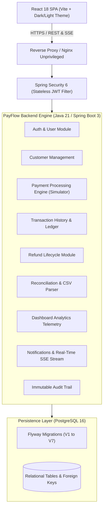

# PayFlow — Enterprise Payment Processing Platform

[](https://openjdk.org/projects/jdk/21/)
[](https://spring.io/projects/spring-boot)
[](https://react.dev/)
[](https://vitejs.dev/)
[](https://www.apache.org/licenses/LICENSE-2.0)

**PayFlow** is a production-style Enterprise Payment Processing Platform designed to demonstrate real-world financial backend engineering, multi-currency processing, idempotent transaction workflows, cumulative refund ceiling safety, bank settlement reconciliation, and real-time event telemetry.

---

## Key Features

- **Multi-Currency Payment Processing**: Deterministic simulated gateway processing for `USD`, `INR`, and `AED`.
- **Strict Monetary Precision**: Zero floating-point arithmetic; all values calculated using `BigDecimal` with 4 decimals and `HALF_UP` rounding.
- **Idempotency Guarantees**: Database-level unique constraint deduplication across payments, refunds, and bank settlement imports.
- **Concurrency & Double-Refund Safety**: Optimistic concurrency control (`@Version`) preventing race conditions on refund operations.
- **Bank Settlement Reconciliation**: CSV file stream ingestion, duplicate detection, automated multi-criteria comparison engine, and injection-safe report export.
- **Enterprise Security & RBAC**: Spring Security 6 stateless JWT bearer authentication supporting `ADMIN`, `OPERATIONS`, and `CUSTOMER` roles.
- **Real-Time Notifications**: Server-Sent Events (SSE) stream for live in-app notifications with client-side unread badges.
- **Comprehensive Analytics & Audit Trail**: Currency-partitioned financial metrics and immutable audit history.
- **Modern Fintech UI**: React 18 SPA featuring light/dark mode, accessible modals, live filters, and notification popovers.

---

## Technology Stack

### Backend
- **Language:** Java 21 (Eclipse Temurin)
- **Framework:** Spring Boot 3.3.5
- **Persistence:** Spring Data JPA / Hibernate 6
- **Database & Migrations:** PostgreSQL 16 & Flyway (V1 to V7)
- **Security:** Spring Security 6 & JJWT (HMAC-SHA256)
- **API Documentation:** SpringDoc OpenAPI 3.0 / Swagger UI
- **Testing:** JUnit 5, Mockito, Spring Boot Test, H2 (In-memory testing)

### Frontend
- **Framework:** React 18 (Vite 5)
- **Routing:** React Router v7
- **HTTP Client:** Axios (Centralized interceptors with automatic Bearer token injection)
- **Icons & Theming:** Lucide React & Custom Dual-Theme CSS (Light / Dark)
- **Testing:** Vitest & React Testing Library (jsdom)

---

## Architecture Diagram



---

## Quick Start & Installation

### Prerequisites
- JDK 21
- Node.js 20+ & npm
- Maven 3.9+ (or portable wrapper)
- Docker & Docker Compose (Optional)

### 1. Database Setup via Docker Compose
```bash
docker compose up -d postgres
```

### 2. Backend Startup
```bash
cd backend
mvn spring-boot:run
```
Backend will start on `http://localhost:8080`.
- **Interactive Swagger UI:** `http://localhost:8080/swagger-ui.html`
- **OpenAPI JSON Spec:** `http://localhost:8080/v3/api-docs`
- **Health Actuator:** `http://localhost:8080/api/health`

### 3. Frontend Startup
```bash
cd frontend
npm install
npm run dev
```
Frontend will be available at `http://localhost:5173`.

---

## Running Automated Tests

### Backend Test Suite (JUnit 5 + Mockito)
```bash
mvn -f backend/pom.xml test
```
*Result: 27 passing tests (0 failures, 0 errors).*

### Frontend Test Suite (Vitest + React Testing Library)
```bash
npm --prefix frontend test
```
*Result: 6 passing tests across 4 suites (0 failures, 0 errors).*

---

## Technical Documentation

Detailed guides are located in the [docs/](file:///c:/Payflow/docs/) directory:
- [Architecture & Modular Monolith Design](file:///c:/Payflow/docs/architecture.md)
- [Database Schema & ERD](file:///c:/Payflow/docs/database-design.md)
- [REST API Specification](file:///c:/Payflow/docs/api-documentation.md)
- [Authentication & Security Architecture](file:///c:/Payflow/docs/authentication-security.md)
- [Payment Lifecycle State Machine](file:///c:/Payflow/docs/payment-lifecycle.md)
- [Refund Concurrency Controls](file:///c:/Payflow/docs/refund-workflow.md)
- [Reconciliation Engine Specification](file:///c:/Payflow/docs/reconciliation-workflow.md)
- [Testing & Quality Assurance Guide](file:///c:/Payflow/docs/testing-guide.md)
- [Cloud Deployment & Docker Setup](file:///c:/Payflow/docs/deployment-guide.md)
- [System Design & Scaling](file:///c:/Payflow/docs/system-design.md)
- [Implementation & Build Status Matrix](file:///c:/Payflow/docs/BUILD_STATUS.md)
