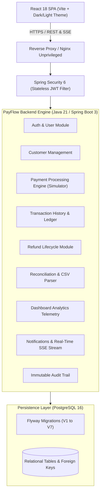

# PayFlow Technical Documentation Index

Welcome to the comprehensive technical documentation for **PayFlow**, a production-style Enterprise Payment Processing Platform.

## Documentation Index

- [Architecture & Modular Monolith Design](file:///c:/Payflow/docs/architecture.md)
- [Database Schema & Entity-Relationship Design](file:///c:/Payflow/docs/database-design.md)
- [REST API Reference & OpenAPI Specification](file:///c:/Payflow/docs/api-documentation.md)
- [Authentication, JWT & Security Architecture](file:///c:/Payflow/docs/authentication-security.md)
- [Payment Processing Lifecycle & Idempotency](file:///c:/Payflow/docs/payment-lifecycle.md)
- [Refund Processing & Concurrency Controls](file:///c:/Payflow/docs/refund-workflow.md)
- [Reconciliation Engine & Bank Settlement Ingestion](file:///c:/Payflow/docs/reconciliation-workflow.md)
- [Quality Assurance & Automated Testing Guide](file:///c:/Payflow/docs/testing-guide.md)
- [Cloud Deployment & Dockerization Guide](file:///c:/Payflow/docs/deployment-guide.md)
- [High-Level System Design & Scaling Considerations](file:///c:/Payflow/docs/system-design.md)
- [Implementation & Build Status Matrix](file:///c:/Payflow/docs/BUILD_STATUS.md)

---

## High-Level Platform Overview

