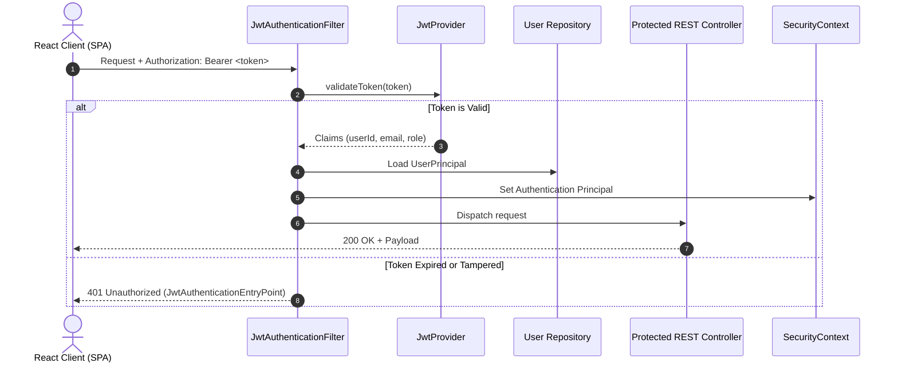

# PayFlow Authentication & Security Architecture

## 1. Security Overview
PayFlow enforces a stateless security model using Spring Security 6, BCrypt password hashing, and signed JWT (JSON Web Tokens) with HMAC-SHA256.

## 2. Role-Based Access Control (RBAC)

| Role | Access Scope |
|---|---|
| `ADMIN` | Full global administrative access: User directory, global audit logs, full system analytics, customer status toggles. |
| `OPERATIONS` | Transaction monitoring, payment authorizations/captures, refund operations, settlement file import, reconciliation execution. |
| `CUSTOMER` | Isolated self-service access: Can only view their own customer profile, create payments for themselves, and view their own transactions and notifications. |

## 3. Financial Invariant Security Controls
- **Zero Floating Point Arithmetic**: All monetary variables use `BigDecimal` with 4 decimal places and explicit `RoundingMode.HALF_UP`.
- **Idempotency Enforcement**: Every write flow (`Payment`, `Refund`) requires unique keys enforced by database unique constraints.
- **Optimistic Concurrency**: `@Version` locking on `Payment` entities guarantees that concurrent refund operations cannot exceed total captured funds.
- **CSV Injection Prevention**: When exporting reconciliation records, formula prefix characters (`=`, `+`, `-`, `@`, `\t`, `\r`) are sanitized by prepending a single quote (`'`).
