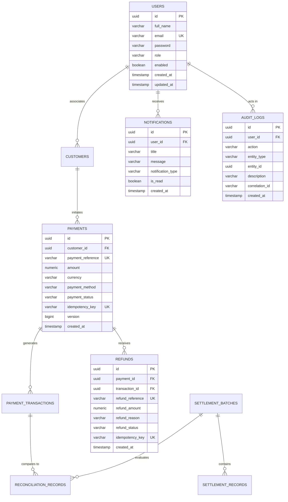

# PayFlow Database Design & Entity Relationships

The PayFlow persistence architecture is backed by PostgreSQL 16, utilizing Flyway for deterministic, forward-only schema migrations.

## 1. Migration History

| Version | Migration Script | Description |
|---|---|---|
| `V1` | `V1__initial_schema.sql` | Primary tables: `users`, `customers`, `payments`, `payment_transactions`, `refunds`, `reconciliation_records`, `audit_logs` |
| `V2` | `V2__customer_user_association.sql` | Links `customers.user_id` to `users.id` with foreign key and index |
| `V3` | `V3__payment_reference_and_version.sql` | Adds `payment_reference` unique column and `@Version` column for optimistic locking |
| `V4` | `V4__transaction_provider_ref_and_desc.sql` | Adds `provider_reference` and `description` to `payment_transactions` |
| `V5` | `V5__refund_reference_and_idempotency.sql` | Adds `refund_reference` and `idempotency_key` unique constraints to `refunds` |
| `V6` | `V6__settlement_and_reconciliation.sql` | Creates `settlement_batches`, `settlement_records`, and extends `reconciliation_records` |
| `V7` | `V7__notifications_and_audit_correlation.sql` | Creates `notifications` table and adds `correlation_id` indexing to `audit_logs` |

---

## 2. Entity-Relationship Diagram

