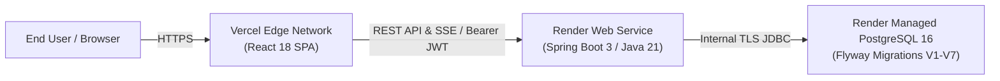

# PayFlow Cloud Deployment Guide (Render, Vercel & Docker)

This guide documents deploying **PayFlow** to **Render** (Spring Boot Backend & PostgreSQL Database) and **Vercel** (React Vite Frontend).

---

## 1. Architecture & Hosting Topology



---

## 2. PostgreSQL Database Setup on Render

1. Log into your [Render Dashboard](https://dashboard.render.com).
2. Click **New +** > **PostgreSQL**.
3. Configure the database details:
   - **Name:** `payflow-postgres`
   - **Database Name:** `payflow_db`
   - **User:** `payflow_user`
   - **Region:** Select a region (e.g. `Oregon (US West)` or `Frankfurt (EU Central)`).
   - **Plan:** Free or Starter.
4. Click **Create Database**.
5. Once created, copy the **Internal Database URL** (recommended for Render services in the same region) or the **External Database URL**.

> [!NOTE]
> Render Free tier PostgreSQL databases expire after 30 days unless upgraded. For production or permanent persistence, upgrade to the Starter plan or configure automated backups via pg_dump.

---

## 3. Backend Deployment on Render

### Step A: Create Web Service
1. In the Render Dashboard, click **New +** > **Web Service**.
2. Connect your Git repository (`PayFlow`).
3. Set the following options:
   - **Name:** `payflow-backend`
   - **Language / Environment:** `Docker` (Render automatically uses [`backend/Dockerfile`](file:///c:/Payflow/backend/Dockerfile)) or `Java`.
   - **Region:** Same region as your database.
   - **Branch:** `main` or `master`.
   - **Root Directory:** Leave empty or set to `backend` if deploying via native Maven.
   - **Build Command (if Native):** `mvn clean package -DskipTests`
   - **Start Command (if Native):** `java -jar target/payflow-backend-1.0.0-SNAPSHOT.jar`
   - **Health Check Path:** `/api/health`

### Step B: Configure Environment Variables
Under the **Environment** tab of your Render Web Service, add:

| Key | Value | Description |
|---|---|---|
| `PORT` | `8080` | Port listened by the container |
| `SPRING_PROFILES_ACTIVE` | `prod` | Activates `application-prod.properties` |
| `SPRING_DATASOURCE_URL` | `jdbc:postgresql://<host>:5432/payflow_db` | Your Render database internal connection string |
| `SPRING_DATASOURCE_USERNAME`| `payflow_user` | Database username |
| `SPRING_DATASOURCE_PASSWORD`| `<your_render_db_password>` | Database password |
| `JWT_SECRET` | `<64_char_hex_secret>` | Secure 256-bit secret key for HMAC-SHA256 JWT signing |
| `CORS_ALLOWED_ORIGINS` | `https://your-frontend.vercel.app,http://localhost:5173` | The public URL of your Vercel deployment |

---

## 4. Frontend Deployment on Vercel

### Step A: Import Project
1. Log into your [Vercel Dashboard](https://vercel.com).
2. Click **Add New...** > **Project**.
3. Import your `PayFlow` Git repository.
4. In the configuration screen:
   - **Framework Preset:** `Vite`
   - **Root Directory:** Click **Edit** and select `frontend`.
   - **Build Command:** `npm run build`
   - **Output Directory:** `dist`

### Step B: Configure Environment Variables
Add the following under **Environment Variables**:

| Key | Value | Description |
|---|---|---|
| `VITE_API_BASE_URL` | `https://payflow-backend.onrender.com` | The public HTTPS URL of your Render backend |

### Step C: Single-Page Application (SPA) Routing
The repository includes [`frontend/vercel.json`](file:///c:/Payflow/frontend/vercel.json):
```json
{
  "version": 2,
  "rewrites": [
    {
      "source": "/(.*)",
      "destination": "/index.html"
    }
  ]
}
```
This ensures all React Router routes (`/analytics`, `/payments`, `/transactions`, `/refunds`, `/reconciliation`, `/audit-logs`) resolve correctly on page refresh without 404 errors.

---

## 5. Local Full-Stack Run with Docker Compose

For local development with PostgreSQL, Spring Boot backend, and React frontend in matching production container environments:

```bash
# 1. Clone repository & copy .env
cp .env.example .env

# 2. Build and launch all 3 tiers
docker-compose up --build -d

# 3. Verify container status
docker-compose ps
```

- **Frontend:** `http://localhost` (or `http://localhost:80`)
- **Backend API & Swagger:** `http://localhost:8080/swagger-ui.html`
- **Health Check:** `http://localhost:8080/api/health`
- **PostgreSQL:** Port `5432`

---

## 6. Continuous Integration & Deployment (GitHub Actions)

The repository includes [`.github/workflows/ci.yml`](file:///c:/Payflow/.github/workflows/ci.yml) which automatically triggers on every pull request and push to `main`:
1. **Backend Pipeline:**
   - Installs JDK 21 (Eclipse Temurin).
   - Runs all 27 unit and integration tests (`mvn test`).
   - Packages executable JAR (`mvn package -DskipTests`).
   - Uploads artifact.
2. **Frontend Pipeline:**
   - Installs Node.js 20.
   - Installs dependencies via `npm ci`.
   - Executes Vitest test suite (`npm test`).
   - Compiles production bundle (`npm run build`).
   - Uploads dist artifact.

---

## 7. Troubleshooting & Free-Tier Considerations

1. **Render Free Tier Spin-Down**:
   - Free instances on Render spin down after 15 minutes of inactivity. The first request after inactivity may take 30–50 seconds to warm up. The frontend handles loading states and timeouts gracefully.
2. **CORS Blocked**:
   - If the frontend reports `Network Error` or CORS policy violation, ensure `CORS_ALLOWED_ORIGINS` on Render contains your exact Vercel URL (e.g. `https://payflow-app.vercel.app`) without trailing slashes.
3. **Database Migration Failures**:
   - Flyway runs automatically on startup. If schema changes conflict with existing tables, verify the database has not been manually altered outside of Flyway version scripts `V1` through `V7`.
