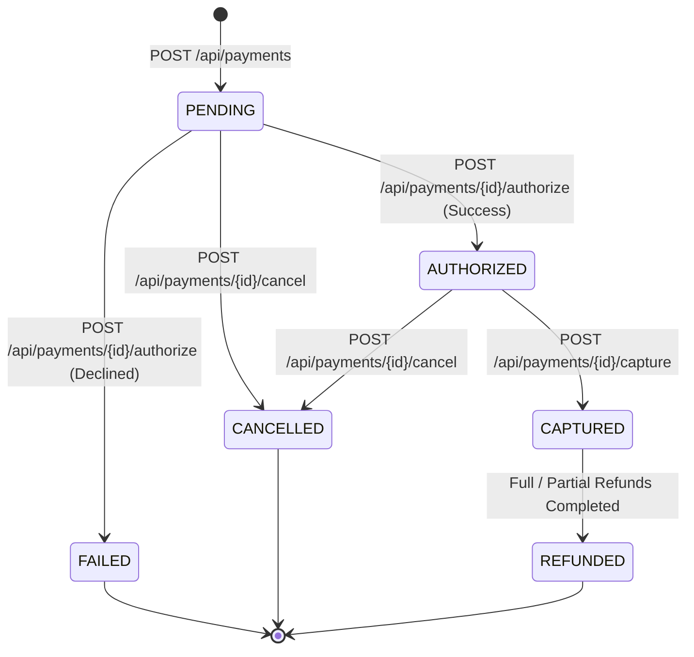

# PayFlow Payment Processing Lifecycle

## State Machine Overview

The payment engine transitions payments through explicit states:

## Lifecycle Steps

1. **Creation (`PENDING`)**:
   - Customer initiates payment specifying amount, currency (`USD`, `INR`, `AED`), and payment method.
   - Enforces unique `idempotencyKey`. If a duplicate request arrives, returns the existing payment record without duplicating state.
   - Creates a `PAYMENT_CREATION` transaction record.

2. **Authorization (`AUTHORIZED` or `FAILED`)**:
   - Dispatches transaction to the simulated payment provider (`SimulatedPaymentProvider`).
   - Successful authorization reserves funds and moves status to `AUTHORIZED`.
   - Generates an `AUTHORIZATION` transaction record with provider reference.

3. **Capture (`CAPTURED`)**:
   - Settles funds for the authorized payment.
   - Generates a `CAPTURE` transaction record. Once captured, funds are eligible for refund operations.

4. **Cancellation (`CANCELLED`)**:
   - Allowed only for payments in `PENDING` or `AUTHORIZED` status. Once captured, funds can only be returned through refunds.
