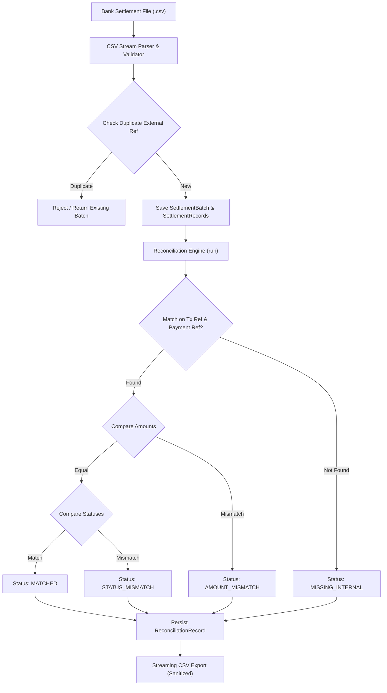

# PayFlow Bank Settlement Reconciliation Workflow

## 1. Process Overview
PayFlow compares internal ledger transactions against external bank settlement files (CSV format) to detect discrepancies.



## 2. Expected CSV Header
```csv
transaction_reference, payment_reference, amount, currency, settlement_date, settlement_status
```
