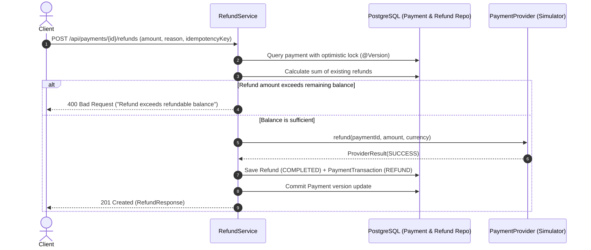

# PayFlow Refund Workflow & Concurrency Controls

## 1. Refund Rules
- Only **CAPTURED** payments are eligible for refund.
- Total cumulative refunds (completed + pending) cannot exceed the original captured payment amount.
- Multiple partial refunds are permitted until the remaining balance reaches zero.
- Re-submitting an identical `idempotencyKey` returns the existing refund record safely.

## 2. Concurrency Sequence

